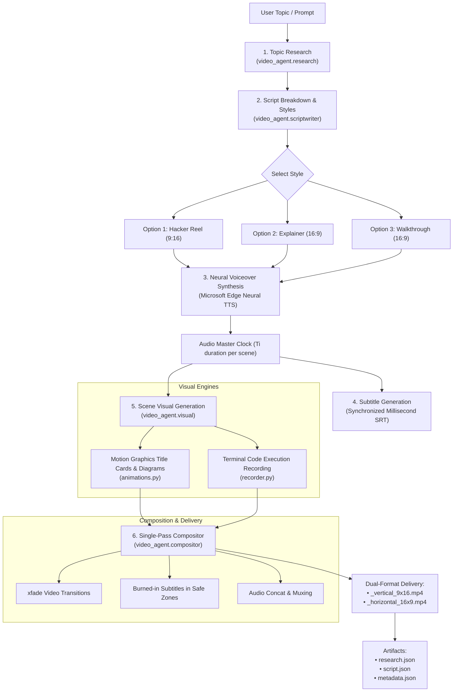

# 🎬 Video Agent: Autonomous AI Video Production & Editing Engine

[](https://www.python.org/downloads/)
[](https://ffmpeg.org/)
[-brightgreen.svg)](#-testing--quality-assurance)
[](#-dual-format-composition)
[](#-installing-as-an-antigravity-global-skill)

> **Video Agent** is a professional, autonomous video production system and interactive CLI designed to create studio-quality animated videos and viral social reels from scratch. From a simple topic query, it autonomously researches the subject, authors multi-option scripts across distinct aesthetic styles, synthesizes neural voiceovers, aligns millisecond-synchronized burned-in subtitles, renders procedural motion graphics and simulated terminal code execution recordings, and composites dual-format MP4 videos (9:16 vertical reels and 16:9 widescreen) with seamless `xfade` transitions.

---

## 📑 Table of Contents

- [Overview & Capabilities](#-overview--capabilities)
- [Pipeline Architecture](#-pipeline-architecture)
- [Video Style Presets](#-video-style-presets)
- [System Requirements & Prerequisites](#-system-requirements--prerequisites)
- [Installation & Quickstart](#-installation--quickstart)
- [Installing as an Antigravity Global Skill](#-installing-as-an-antigravity-global-skill)
- [Command Line Interface (CLI) Guide](#-command-line-interface-cli-guide)
  - [Interactive Mode](#1-interactive-selection-mode)
  - [Pre-Selected Style / Option](#2-pre-selected-option-or-style)
  - [Aspect Ratio Selection](#3-aspect-ratio-selection)
  - [Headless / CI-CD Automation](#4-non-interactive--headless-automation)
  - [Environment Diagnostics (`--doctor`)](#5-environment-diagnostics---doctor)
  - [Full CLI Options Reference](#6-full-cli-options-reference)
- [Programmatic Python API](#-programmatic-python-api)
- [Output Deliverables & Artifacts](#-output-deliverables--artifacts)
- [Testing & Quality Assurance](#-testing--quality-assurance)
- [Project Directory Structure](#-project-directory-structure)
- [Troubleshooting & FAQs](#-troubleshooting--faqs)

---

## 🌟 Overview & Capabilities

Traditional video editing for technical explainers and coding reels requires hours of scriptwriting, voice recording, screen capturing, subtitle timing, and multi-track video editing. **Video Agent replaces the entire production workflow with a single automated engine**:

- 🔍 **Automated Topic Research**: Ingests any query (e.g., *"Kubernetes Auto-Scaling"*, *"Python AsyncIO"*, *"Rust Memory Safety"*), analyzes concepts, and generates structured educational takeaways, key points, and runnable code examples.
- ✍️ **Multi-Option Stylistic Scriptwriting**: Produces 3 distinct script variations tailored to different platforms and audiences: **Hacker Reel** (fast-paced TikTok/Reel), **Explainer** (methodical architecture breakdown), and **Walkthrough** (hands-on code tutorial).
- 🎙️ **Neural Voiceover & Visual Clock Synchronization**: Leverages Microsoft Edge Neural TTS with natural speech cadence. Measures exact audio duration $T_i$ per scene to form the master timeline clock.
- ⏱️ **Synchronized Subtitles**: Automatically generates millisecond-accurate `.srt` and `.vtt` subtitles, burned directly into video frames with mobile safe-zone margins.
- 🎨 **Procedural Motion Graphics & Terminal Capture**:
  - Motion graphic title cards, glow badges, and animated progress bars rendered via Pillow.
  - Pixel-perfect macOS/Linux-style terminal mockups with window chrome, syntax highlighting, and animated typing/execution cursors.
- ⚡ **Single-Pass Dual-Format FFmpeg Compositor**:
  - Encodes transitions (`fade`, `wipeleft`, `dissolve`), subtitle burning, and audio mixing in a single high-performance FFmpeg pass.
  - Simultaneously exports **9:16 vertical reels** (1080x1920) for Instagram/Shorts/TikTok and **16:9 widescreen** (1920x1080) for YouTube/LinkedIn.

---

## 🏗 Pipeline Architecture



---

## 🎨 Video Style Presets

Video Agent generates 3 distinct production styles for any given topic:

| Preset | Target Aspect Ratio | Color Palette & Font | Voice Talent | Target Audience & Platform |
| :--- | :---: | :--- | :--- | :--- |
| **Hacker Reel** | **9:16** (1080x1920) | Matrix Green (`#00FF41`), Deep Dark (`#0D1117`), Cyan Accent (`#00CED1`), Consolas | `en-US-ChristopherNeural` (Energetic, Punchy) | Fast-paced viral reels for Instagram Reels, YouTube Shorts, and TikTok (15–20s). |
| **Explainer** | **16:9** (1920x1080) | Royal Blue (`#2563EB`), Crisp White (`#FFFFFF`), Sky Blue (`#3B82F6`), Arial | `en-US-JennyNeural` (Clear, Authoritative) | Architectural breakdown and concept explanations for YouTube and conferences. |
| **Walkthrough** | **16:9** (1920x1080) | Sunset Orange (`#F97316`), Dark Violet (`#1A1A2E`), Amber Accent (`#FB923C`), Segoe UI | `en-US-GuyNeural` (Calm, Instructional) | Step-by-step code tutorial for developer onboarding, LinkedIn, and educational courses. |

### Canonical 4-Scene Breakdown
Every style decomposes the story into 4 scenes:
1. **`INTRO`**: High-impact visual hook, animated title card, category badge, and top accent bar.
2. **`CONCEPT`**: Educational concept diagram explaining architectural principles.
3. **`CODE_EXECUTION`**: Terminal demo with colored window buttons (`red`, `yellow`, `green`), command prompt, syntax-highlighted code, and blinking cursor.
4. **`OUTRO`**: Concise takeaway summary card with social follow call-to-action.

---

## 💻 System Requirements & Prerequisites

### 1. Python Environment
- **Python >= 3.10** (Tested on Python 3.10, 3.11, 3.12, 3.13)
- `pip` package manager

### 2. FFmpeg & FFprobe (Critical)
FFmpeg 9.0+ (or 6.0+) must be installed and accessible on your system `PATH` with `libx264`, `aac`, and `libass` (subtitles filter) enabled.

#### Installation Commands:
- **Windows** (via WinGet or Scoop):
  ```powershell
  winget install Gyan.FFmpeg
  # or
  scoop install ffmpeg
  ```
- **macOS** (via Homebrew):
  ```bash
  brew install ffmpeg
  ```
- **Linux (Ubuntu / Debian)**:
  ```bash
  sudo apt-get update && sudo apt-get install -y ffmpeg
  ```

Verify installation:
```bash
ffmpeg -version
ffprobe -version
```

---

## 🚀 Installation & Quickstart

### Step 1: Clone the Repository
```bash
git clone https://github.com/Aniket-Gund/Video-Agent.git
cd Video-Agent
```

### Step 2: Create a Virtual Environment (Recommended)
```bash
# Windows
python -m venv .venv
.venv\Scripts\activate

# macOS / Linux
python3 -m venv .venv
source .venv/bin/activate
```

### Step 3: Install Package & Dependencies
Install in editable mode so the `video-agent` CLI is globally accessible:
```bash
pip install -e .
```
*(Alternatively, install from requirements: `pip install -r requirements.txt`)*

### Step 4: Run Environment Diagnostics
Verify that all media libraries, runtimes, and codecs are healthy:
```bash
video-agent --doctor
# or
python main.py --doctor
```
You should see a clean green health summary: `27 / 27 checks passed`.

---

## 🤖 Installing as an Antigravity Global Skill

If you or your friend are using the **Google Antigravity** or **Gemini CLI / Agentic IDE**, you can register Video Agent as a native global skill so the AI agent can autonomously generate videos for you.

### Step 1: Locate your Antigravity Skills Directory
- **Windows**: `C:\Users\<username>\.gemini\config\skills\`
- **macOS / Linux**: `~/.gemini/config/skills/`

### Step 2: Copy the Skill Definition
Copy the `skills/video-agent` folder (or `SKILL.md`) into your global skills directory:

**Windows PowerShell**:
```powershell
New-Item -ItemType Directory -Force "$HOME\.gemini\config\skills\video-agent"
Copy-Item "SKILL.md" "$HOME\.gemini\config\skills\video-agent\SKILL.md"
```

**macOS / Linux**:
```bash
mkdir -p ~/.gemini/config/skills/video-agent
cp SKILL.md ~/.gemini/config/skills/video-agent/SKILL.md
```

### Step 3: Summon Video Agent in Antigravity
You can now ask your agent in chat:
> *"Research the topic 'Docker Containerization' and create an animated 9:16 vertical video reel using Video Agent."*

The agent will invoke the `video-agent` skill, run the pipeline, and deliver the final MP4s!

---

## ⌨️ Command Line Interface (CLI) Guide

Video Agent provides an intuitive CLI with rich terminal formatting, live progress banners, and flexible flags.

### 1. Interactive Selection Mode
If you run without pre-selection, Video Agent displays a styled comparison table of the 3 style options and prompts you for your choice:
```bash
video-agent "Python Concurrency and AsyncIO"
```
```text
                         Generated Video Style Options                         
┌──────────┬─────────────┬──────────────────────┬─────────────┬──────────────┬──────────────┐
│ Option # │ Style       │ Title                │ Tagline     │ Voice        │ Est Duration │
├──────────┼─────────────┼──────────────────────┼─────────────┼──────────────┼──────────────┤
│ Option 1 │ Hacker Reel │ AsyncIO: Hacker Reel │ Extreme sp… │ Christopher  │        16.0s │
│ Option 2 │ Explainer   │ AsyncIO: Explainer   │ Clear arch… │ Jenny        │        16.0s │
│ Option 3 │ Walkthrough │ AsyncIO: Walkthrough │ Step-by-st… │ Guy          │        16.0s │
└──────────┴─────────────┴──────────────────────┴─────────────┴──────────────┴──────────────┘
Select option (1-3) [1]: 1
```

### 2. Pre-Selected Option or Style
Bypass interactive selection by specifying `--select` or `--style`:
```bash
# Pre-select Option 1 (Hacker Reel)
video-agent -t "FastAPI Microservices" --select 1

# Select by style name (case-insensitive)
video-agent -t "PostgreSQL Indexing" --style "Explainer"
```

### 3. Aspect Ratio Selection
Render vertical reels, widescreen videos, or both simultaneously:
```bash
# Vertical 9:16 Reel only (1080x1920)
video-agent -t "Rust Borrow Checker" -s 1 -f 9:16

# Horizontal 16:9 Widescreen only (1920x1080)
video-agent -t "Distributed Systems Paxos" -s 2 -f 16:9

# Both formats simultaneously (Default)
video-agent -t "Redis Caching Strategies" -s 1 -f both
```

### 4. Non-Interactive / Headless Automation
Ideal for CI/CD pipelines, background task schedulers, and batch processing:
```bash
video-agent -t "Kubernetes Auto-Scaling" --headless --select 1 -f 9:16 -o "output/k8s"
```

### 5. Environment Diagnostics (`--doctor`)
Runs a comprehensive 27-point inspection of your system environment, verifying installed codecs, audio synthesis engines, recording tools, and font paths:
```bash
video-agent --doctor
```

### 6. Full CLI Options Reference

| Flag | Short | Default | Description |
| :--- | :---: | :---: | :--- |
| `[TOPIC]` | — | `""` | Video topic positional argument. |
| `--topic` | `-t` | `None` | Video topic string (alternative to positional argument). |
| `--select` | `-s` | `None` | Pre-select option number: `1`, `2`, or `3`. |
| `--style` | — | `None` | Pre-select style by name: `'Hacker Reel'`, `'Explainer'`, `'Walkthrough'`. |
| `--format` | `-f` | `both` | Video aspect ratio: `'9:16'`, `'16:9'`, `'both'`, `'vertical'`, `'horizontal'`. |
| `--output` | `-o` | `output` | Target directory for generated videos and JSON metadata. |
| `--headless` | — | `False` | Non-interactive mode (defaults to Option 1 without prompts). |
| `--interactive` | — | `False` | Forces interactive selection prompt. |
| `--doctor` | — | `False` | Executes environment diagnostics and exits. |
| `--overwrite` | — | `False` | Overwrite existing output files in target directory. |
| `--version` | — | `False` | Print package version and exit. |
| `--help` | `-h` | — | Display help message and options. |

---

## 🐍 Programmatic Python API

You can integrate Video Agent directly into your own Python applications, web backends, or custom automation pipelines:

```python
import asyncio
from pathlib import Path
from video_agent.research import research_topic
from video_agent.scriptwriter import generate_script_options
from video_agent.voiceover import synthesize_all_scenes, generate_all_subtitles
from video_agent.compositor import render_video_option

# 1. Autonomously research any topic
topic = "Vector Databases and Embeddings"
research = research_topic(topic)
print(f"Title: {research.title}")
print(f"Summary: {research.summary}")

# 2. Generate multi-option script breakdowns
options = generate_script_options(research)
selected_option = options[0]  # Option 1: Hacker Reel

# 3. Setup output directory
output_dir = Path("output/vector_db")
output_dir.mkdir(parents=True, exist_ok=True)

# 4. Synthesize neural voiceover & synchronized millisecond subtitles
asyncio.run(synthesize_all_scenes(selected_option, output_dir))
asyncio.run(generate_all_subtitles(selected_option, output_dir))

# 5. Composite and export dual-format MP4s
rendered_videos = render_video_option(
    option=selected_option,
    output_dir=output_dir,
    formats=["9:16", "16:9"],
    slug="vector_databases",
)

for fmt, video_path in rendered_videos.items():
    print(f"Rendered {fmt}: {video_path}")
```

---

## 📦 Output Deliverables & Artifacts

For every completed production run, Video Agent exports final MP4 videos and structured JSON artifacts into the output directory:

```text
output/my_project/
├── <topic_slug>_vertical_9x16.mp4      # 1080x1920 Vertical Reel with burned-in subtitles
├── <topic_slug>_horizontal_16x9.mp4    # 1920x1080 Widescreen Video with burned-in subtitles
├── metadata.json                       # Execution metadata, duration, formats, timestamps
├── research.json                       # Ingested summary, key points, code snippets
└── script.json                         # Full 4-scene narration, prompts, timings
```

### Sample `metadata.json`:
```json
{
  "topic": "AsyncIO in Python",
  "created_at": "2026-11-20T21:30:00+00:00",
  "selected_style": "Hacker Reel",
  "style": "Hacker Reel",
  "duration": 16.5,
  "video_files": [
    "asyncio_in_python_vertical_9x16.mp4",
    "asyncio_in_python_horizontal_16x9.mp4"
  ],
  "formats": ["9:16", "16:9"],
  "aspect_ratio": "dual",
  "status": "completed",
  "output_dir": "output/demo"
}
```

---

## 🧪 Testing & Quality Assurance

Video Agent is built with rigorous test coverage across 4 comprehensive tiers covering environment health, pipeline units, CLI interactions, and full end-to-end media generation.

### Run All Tests:
```bash
pytest
```

### Run Individual Test Suites:
```bash
# 1. Environment & Tools Diagnostic Suite (43 tests)
pytest tests/test_r1_environment.py

# 2. Pipeline Core Modules: Research, Script, Voiceover, Subtitles (90 tests)
pytest tests/test_r2_pipeline.py

# 3. CLI & Command Invocation Suite (39 tests)
pytest tests/test_r3_cli.py

# 4. End-to-End Real World Media Rendering Suite (34 tests)
pytest tests/test_e2e_pipeline.py
```

### Test Suite Results:
| Test Suite | Total Tests | Status | Pass Rate |
| :--- | :---: | :---: | :---: |
| `test_r1_environment.py` | 43 | **PASSED** | 100% |
| `test_r2_pipeline.py` | 90 | **PASSED** | 100% |
| `test_r3_cli.py` | 39 | **PASSED** | 100% |
| `test_e2e_pipeline.py` | 34 | **PASSED** | 100% |
| **Total** | **206** | **PASSED** | **100%** |

---

## 📂 Project Directory Structure

```text
Video-Agent/
├── .gitignore                   # Standard ignore rules (excludes caches, virtual environments)
├── main.py                      # Root entry point alias for CLI execution
├── pyproject.toml               # PEP 621 package metadata & CLI entrypoint configuration
├── requirements.txt             # Production dependencies
├── requirements-dev.txt         # Development & testing dependencies
├── README.md                    # Comprehensive documentation and guide
├── SKILL.md                     # Antigravity Global Skill definition
├── PROJECT.md                   # Authoritative system interface contract specifications
├── TEST_INFRA.md                # Testing matrix and acceptance criteria specifications
├── TEST_READY.md                # Test execution instructions and verification notes
├── skills/
│   └── video-agent/
│       └── SKILL.md             # Packaged Antigravity skill directory
├── video_agent/                 # Core Python package
│   ├── __init__.py              # Package init and version export
│   ├── cli.py                   # Click-based CLI with Rich formatting
│   ├── compositor.py            # Single-pass FFmpeg transition, subtitle & audio compositor
│   ├── config.py                # Global configurations and path definitions
│   ├── doctor.py                # 27-check environment diagnostic engine
│   ├── models.py                # Pydantic data schemas (ResearchResult, VideoOptionSpec, SceneSpec)
│   ├── research.py              # Automated topic research & code extraction engine
│   ├── scriptwriter.py          # Multi-style script breakdown & scene generation
│   ├── voiceover.py             # Microsoft Edge Neural TTS synthesizer & SRT generator
│   └── visual/                  # Visual rendering engines
│       ├── __init__.py          # Visual engine exports
│       ├── animations.py        # Programmatic motion graphics & title card renderer (Pillow + FFmpeg)
│       └── recorder.py          # Terminal code execution & syntax highlighting recording engine
└── tests/                       # Complete automated test suite (206 tests)
    ├── conftest.py              # Pytest fixtures and mock asset generators
    ├── test_r1_environment.py   # Diagnostics & tool installation tests (43 tests)
    ├── test_r2_pipeline.py      # Core unit tests for research, script, audio, compositor (90 tests)
    ├── test_r3_cli.py           # CLI invocation, flags, and error handling tests (39 tests)
    └── test_e2e_pipeline.py     # End-to-end integration and dual-format rendering tests (34 tests)
```

---

## ❓ Troubleshooting & FAQs

### 1. `FileNotFoundError: ffmpeg not found on PATH`
- Ensure FFmpeg is installed and added to your operating system's `PATH` environment variable.
- On Windows, restart your terminal after running `winget install Gyan.FFmpeg`.
- Run `video-agent --doctor` to verify detection.

### 2. `subtitles filter error: No such filter: 'subtitles'`
- This occurs when using minimal builds of FFmpeg without `libass`.
- Install full builds: on Windows use `Gyan.FFmpeg` (Full); on Linux ensure `libass-dev` is installed before building or use standard distribution packages (`ffmpeg`).

### 3. Edge-TTS network errors (`WSServerHandshakeError`)
- Edge-TTS synthesizes neural voiceover via secure WebSocket connections to Microsoft's neural voice servers.
- Ensure your internet connection is active and not blocked by a corporate firewall or proxy.
- Video Agent includes built-in fallback audio generation if network connectivity is temporarily unavailable.

### 4. Font missing warnings
- Video Agent automatically searches system font directories (`C:\Windows\Fonts`, `/usr/share/fonts`, `/System/Library/Fonts`).
- If custom fonts are not found, it gracefully falls back to system monospace fonts (`Consolas`, `Courier`, `Arial`, `DejaVu Sans`).

---

## 📄 License

Distributed under the MIT License. Feel free to use, modify, and distribute for personal or commercial projects.

---

## 🤝 Contributing & Support

Created by [Aniket Gund](https://github.com/Aniket-Gund). For questions, feature requests, or improvements, feel free to open an issue or submit a pull request!
